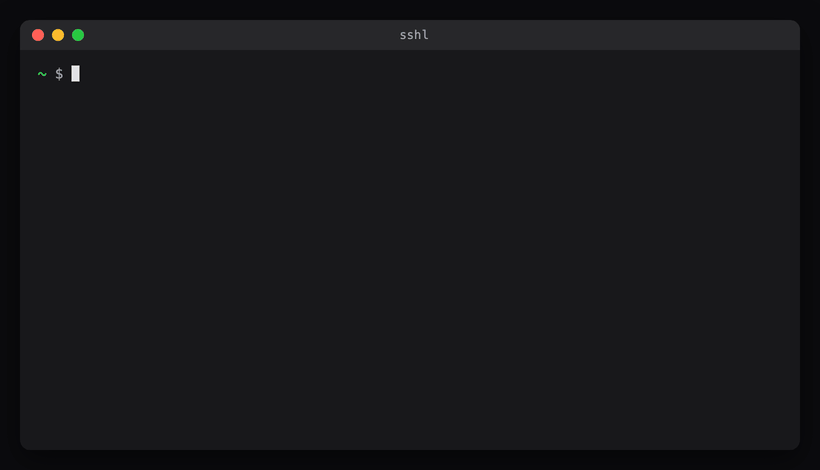

# sshl

**List the hosts in your `~/.ssh/config` — every alias, address, user and how each one is reached — in one readable table.**



You have twenty hosts, three jump boxes and a Cloudflare tunnel, and you can never remember whether it was `ssh web` or `ssh web-01`. `sshl` reads your SSH config and shows you.

```
$ sshl

  ALIASES          ADDRESS          USER    VIA

Home lab
  proxmox pve 100  192.168.10.10    root
  pve-admin        192.168.10.10    root
  web 110          192.168.20.5     deploy  jump pve
  nas 120          192.168.10.20    admin
  pve-remote       ssh.example.com  root    cloudflared

Work
  prod 200         10.0.3.4         app     jump bastion
  staging 201      10.0.3.5         app     jump bastion

7 hosts · connect with: ssh <alias>
```

## Install

It is one Python 3 file with no dependencies. Python 3 ships with macOS and most Linux distributions.

```sh
mkdir -p ~/.local/bin
curl -fsSL https://raw.githubusercontent.com/rvogel/sshl/main/sshl -o ~/.local/bin/sshl
chmod +x ~/.local/bin/sshl
```

`~/.local/bin` must be on your `PATH`. If `sshl` is not found, add this to `~/.zshrc` or `~/.bashrc`:

```sh
export PATH="$HOME/.local/bin:$PATH"
```

Or clone the repository and link the script, so `git pull` updates it:

```sh
git clone https://github.com/rvogel/sshl.git
ln -s "$PWD/sshl/sshl" ~/.local/bin/sshl
```

## Use

| Command | What it shows |
| --- | --- |
| `sshl` | Every host |
| `sshl prod` | Hosts whose alias, address or section contains `prod` |
| `sshl 10.0.3` | Hosts on that subnet |
| `sshl -F path/to/config` | Another config file (or set `SSHL_CONFIG`) |
| `sshl --help` · `sshl --version` | Help · version |

Colour is used only on a terminal. Set `NO_COLOR` to turn it off.

## How it reads your config

- **Sections** come from your own comments. A comment line right after a rule of `#` characters starts a section:

  ```
  ##################################################
  ## Home lab
  ```

  Hosts before the first section are listed under *(no section)*.
- **Order inside a section** is by the numeric alias, if a host has one: a VM or container ID such as `Host web 110`. A host with no number is listed beside the host with the same address, so `pve-admin` sits next to `proxmox pve 100`. Hosts with neither come last, by IP.
- **VIA** shows `jump <host>` for `ProxyJump`, `cloudflared` for a Cloudflare Access `ProxyCommand`, and `proxy` for any other `ProxyCommand`.
- **First value wins** inside a `Host` block, as in ssh itself.
- **`Include`** lines are followed, including globs and paths relative to the config.
- **`Host *`**, other wildcard patterns and **`Match`** blocks are skipped. They configure many hosts and are not hosts you can name.

`sshl` only reads your config. It never connects anywhere and never writes a file.

## Tests

```sh
python3 -m unittest discover -s tests
```

The demo GIF is built from the test fixture (all hosts and addresses are made up) with `python3 docs/make_demo.py` — it needs Google Chrome and ffmpeg.

## License

[MIT](LICENSE) © 2026 Rafael Vogel
